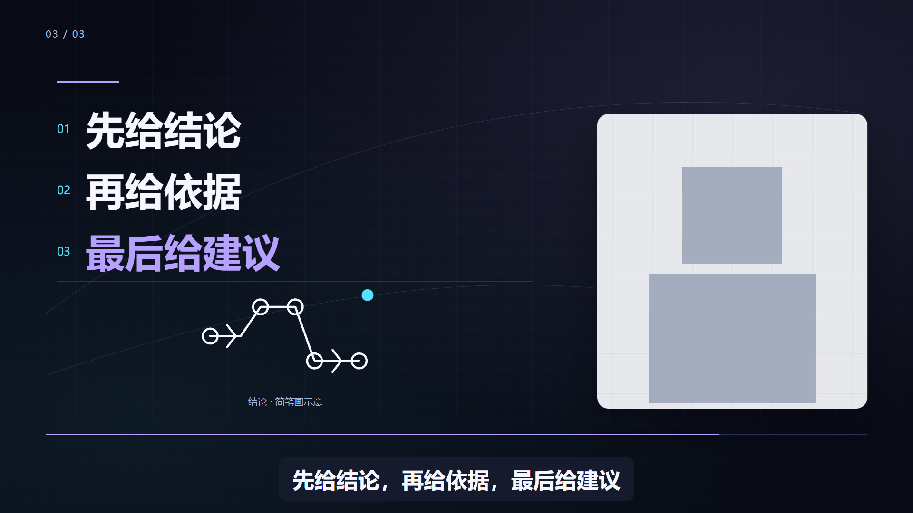

# AI Self-Media Video Packaging Skill

这是我创建的 AI 口播视频包装项目：把视频与对应 SRT 转成可审阅的分镜方案，再用 Remotion 生成带标题、侧卡和流程信息的成片。适合 AI 自媒体讲解、知识分享和操作说明，保留原声与字幕，并检查输出是否可以完整解码。

## 可以做什么

|功能|说明|
|---|---|
|配色|dark 深色、paper 浅色；紫色标重点、青色标过程、少量暖色标结果，每条视频保持统一风格|
|排版|title 开场标题、card 侧边信息卡、flow 两至三个原稿条目的展示|
|真人镜头|一个连续人物画面在全幅、左右分栏与单窗之间收放；可选1.06倍轻推近|
|动效|标题逐行揭示、关键词划线、人物窗口描边、单窗收放、条目错峰、简笔画描线与流动提示|
|简笔画|手机镜像、文案收集、Agent输出与六种已有线稿，按语义描线出现并标明“示意”|
|交付检查|字幕、安全区、连续原声、完整解码、黑帧和文件哈希|

输入采用已经剪好的视频与准确、同步的 SRT。项目不会自动修正口误，也不会根据零散词语编造数字、操作步骤或结论。

当前 CLI 使用三版式工作流，内部标识为 `public-lite`。v0.4开始支持单窗人物构图；已有V2工程与旧三版式工程保持读取兼容。

## 前期素材准备

先剪好原片与对应字幕。本Skill不处理重读、漏读和气口，不重排讲解，不追加原稿没有的数字、操作步骤或结论。

- **视频 + SRT**：默认推荐，直接合成 MP4，检查真人位置与字幕。
- **只提供 SRT**：按明确的画布尺寸生成透明 MOV，不能据此判断真实人物是否被挡。

字幕模式：

- 原视频已经带有字幕（字幕已固定在画面中）：`--captions burned-in`。
- 原视频没有字幕，希望 Skill 自动生成字幕：`--captions generated`。
- 原视频没有字幕，并且只需要动效、不需要字幕：`--captions none`。

启用真人轻推近时，原视频底部字幕会由当前SRT重绘，保证内容完整，不叠两层字幕。若SRT与原声不同步，先修复输入。

## 安装与使用

需要Node.js 20+、FFmpeg和ffprobe。当前支持16:9横屏输入，透明输出也使用16:9画布。

```bash
git clone https://github.com/zhouyuechuan2025-ui/ai-self-media-video-packaging-skill.git
cd ai-self-media-video-packaging-skill
npm ci
```

四步逐级审核；下列命令的输入与风格必须保持一致：

```bash
# Gate A：只写方案
npm run package-video -- --video INPUT.mp4 --srt INPUT.srt --out RUN --output-mode composite --captions burned-in --style dark
# Gate B：制作工程输入
npm run package-video -- --video INPUT.mp4 --srt INPUT.srt --out RUN --output-mode composite --captions burned-in --style dark --approve-gate-a --approve-gate-b
# Gate C：8个时间轴抽帧，人工检查，不导出最终视频
npm run package-video -- --video INPUT.mp4 --srt INPUT.srt --out RUN --output-mode composite --captions burned-in --style dark --approve-gate-a --approve-gate-b --approve-gate-c
# Gate D：完整MP4与验收记录
npm run package-video -- --video INPUT.mp4 --srt INPUT.srt --out RUN --output-mode composite --captions burned-in --style dark --approve-gate-a --approve-gate-b --approve-gate-c --approve-gate-d --render
# 透明MOV，画布需与目标工程一致
npm run package-video -- --srt INPUT.srt --out RUN --output-mode overlay --width 1920 --height 1080 --fps 30
```

所有阶段可用 `--style paper`。合成MP4默认使用 `--presenter-layout single`，人物以唯一连续视频参与构图；`--presenter-layout original`保留原有侧卡方式。需要全幅画面的轻推近时，添加 `--presenter-motion subtle`，默认 `off`。透明输出只支持 `original`，不包含真人原片。当前工作流使用Remotion；HyperFrames适配器用于维护已有V2工程。

Agent应先逐句分析语义，并用 `--direction DIRECTION.json` 提炼原句关键词与构图意图。该文件按SRT序号指定 `mode`、`lines`、可选 `eyebrow` 和 `highlight`，每个上屏词必须原样出现在对应原句中。它只描述展示方式，不改字幕、原声或源视频。示例见 [direction.json](examples/current-demo/direction.json)。所有审核阶段保持相同输入和参数。

需要简笔画时，在相应方向条目中加入 `"doodle": {"type": "phone-mirror", "label": "屏幕镜像"}`。标签必须取自该句原稿；图形是概念示意，不是真实设备操作或截图。当前简笔画用于单窗合成MP4，图形区与文字、人物和字幕分开。支持的类型见 [功能与限制](references/public-lite.md)。

v0.6细化了动效与排版：每页先建立构图，再揭示重点，描线后给出一次流动提示，随后保持阅读停留。辅助色按语义分工，不逐句随机换色。真人原色与唯一原声保持不变。

## 检查与限制

```bash
npm test
npm run typecheck
npm run build
npm run verify:public
```

检查源文件哈希、文字与脸部安全区、字幕、首尾和转场、完整解码、黑帧与输出哈希。抽帧、构建成功和解码通过都不能替代完整播放或用户验收。

居中人物使用左右安全区，底部18%预留字幕；单窗模式裁掉源字幕区域并从SRT完整重绘一次，文字与人物分栏。原始构图模式的全屏标题与流程使用不透明底色。三种语义版式不需要凑八种结构，长片也应按语义编排。两套风格逐片统一，标题取原稿关键词，超长句保留完整字幕。

详细规则：[功能与限制](references/public-lite.md)、[审核阶段](references/gates.md)、[画面检查](references/visual-quality-gates.md)。

## 当前示例：三版式与两种配色

以下截图由本项目当前渲染器生成，使用可复现的合成测试画面与示例文案，不是真人口播案例，也不作为外部事实的证据。





示例字幕与生成方法见 [示例目录](examples/current-demo/README.md)。

## 当前简笔画示例


此图由当前代码与示例文案生成。首页不再使用旧V2案例截图；真人素材与试看片留在本地，上面的公开示例明确使用合成画面。

如果有更多AI学习需要，或AI自媒体项目陪跑服务，欢迎咨询业务微信：nanaya093


